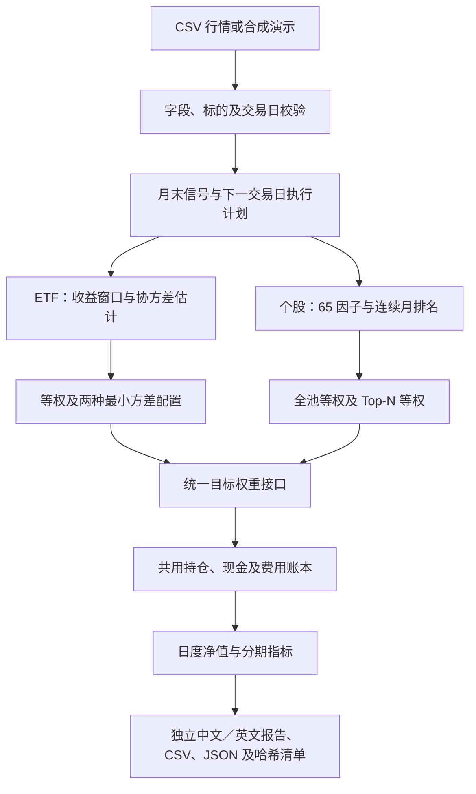
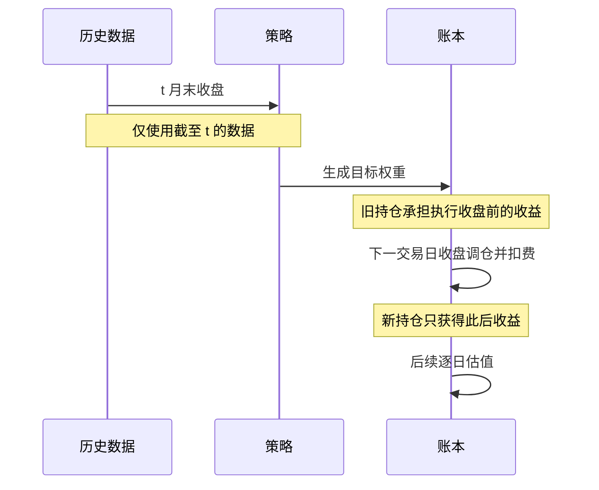

# Quant Research Lab · 量化研究与回测框架

**将行业 ETF 风险配置与个股因子选股放进同一套月度研究框架。**

**本项目由四位成员共同研发。**

项目研究两个问题：协方差估计方法如何影响行业 ETF 配置，以及价格／成交量因子排名如何影响个股组合。两类策略使用同一套调仓、成本与净值计算口径，便于核对方法差异。工程可复现性与策略预测能力分别验证。

当前版本：**v0.1.0 本地候选版本**。v1.0 日度、v2.0 小时级、v3.0 AI 分钟／秒级能力见[版本路线](docs/VERSION_ROADMAP_ZH.md)，不属于当前已实现功能。

语言：[中文](README.md) · [English](README_EN.md)

阅读入口：[中文纯文字版](readme.txt) · [方法与读图说明](docs/METHODOLOGY.md) · [因子目录](docs/FACTOR_CATALOG.md) · [验证记录](docs/VALIDATION.md) · [版本路线](docs/VERSION_ROADMAP_ZH.md) · [上传指南](docs/GITHUB_UPLOAD_ZH.md)

## 当前范围

| 策略族 | 输入与方法 | 共用能力 |
| --- | --- | --- |
| 行业 ETF | 固定 11 只行业 ETF；等权、样本协方差最小方差、常相关收缩最小方差 | 交易日校验、月末信号、下一交易日收盘执行、持仓／现金／交易成本账本、日度净值与指标 |
| 个股 | 日度 OHLCV 与复权收盘价；价格／成交量因子排名，选取排名靠前股票并等权配置 | 复用 ETF 核心的月度调度与组合记账，统一命令行入口与报告输出 |

ETF 比较三种策略：`equal_weight`、`sample_min_variance`、`shrinkage_min_variance`。默认池为 `XLB, XLC, XLE, XLF, XLI, XLK, XLP, XLRE, XLU, XLV, XLY`。

个股比较 `equal_weight`（整个配置池等权）与 `multifactor_top_n`（排名前 N 只等权）。默认池为 `AAPL, MSFT, GOOGL, AMZN, NVDA, META, JPM, JNJ, XOM, PG`，属于固定研究池，并非历史指数成分。两者均按月调仓并收取费用。

个股指标目录有 **100 个候选，其中 65 个已实现**：动量 20、反转 10、风险 15、流动性 20。价值 15、质量 10、成长 10 合计 35 个仍缺少具有历史可用时间的财务数据；它们不是已完成的因子，也不会用零替代。详见[指标目录](docs/FACTOR_CATALOG.md)。指标方向和分组权重是待检验假设，数量不代表预测能力。

个股默认流程：65 个因子全部有效 → 调整方向并计算横截面百分位 → 组内平均 → 按动量 30%、反转 10%、风险 40%、流动性 20% 加权 → 平均连续 3 个月的排名百分位 → 重排后取前 4 只等权。最终并列按股票代码升序处理；公式和筛选图见[方法说明](docs/METHODOLOGY.md)。

“月计算”指每月产生一次交易决策；日度数据用于估计风险和记录持仓变化。账本使用复权价格对应的合成份额，包含买卖费用和首次建仓成本，不是经独立认证的原始股数与现金分红账本。

## 统一框架流程



两条研究分支在目标权重处汇合，之后由 `evaluate_targets` 使用相同的执行与记账逻辑。图中的月度调度不表示每月只读取一条价格。

## 安装与离线演示

需要 Python 3.11+；本地验证和 CI 配置使用 Python 3.13。首次安装依赖可能联网，安装完成后的 demo 无需下载行情或提供行情账户。

Windows PowerShell，在项目根目录运行；下列写法无需激活脚本：

```powershell
python -m venv .venv
.\.venv\Scripts\python.exe -m pip install .
.\.venv\Scripts\python.exe -m quant_research demo --output outputs/demo
.\.venv\Scripts\python.exe -m quant_research demo --family stocks --output outputs/stock_demo
```

macOS／Linux：

```bash
python3 -m venv .venv
.venv/bin/python -m pip install .
.venv/bin/python -m quant_research demo --output outputs/demo
.venv/bin/python -m quant_research demo --family stocks --output outputs/stock_demo
```

下文的 `python` 指这个已安装依赖的虚拟环境解释器；也可继续使用上面的完整路径。激活环境后，还可使用 `quant-research` 命令替代 `python -m quant_research`。

两个演示均在本地生成确定性合成行情。输出位于指定目录；用浏览器打开命令打印的 `report.html` 路径即可查看。输出目录必须不存在或为空，以保留先前实验。每个 demo 附带 `demo_prices.csv`，可用 `run --prices` 重跑；这些文件仍然是合成数据。**合成演示用于检查程序链路，其净值和收益不构成市场表现、策略有效性或投资回报证据。**

统一入口分别生成**中文报告 `report_zh.html`** 与**英文报告 `report_en.html`**，涵盖标题、图表、表格、指标说明、方法约定及证据边界。`report.html` 是中英语言选择入口，两份报告共用同一份计算结果；CSV 与 JSON 的字段名保留英文，便于程序读取。

已验证 Windows／Python 3.13 的完整依赖快照见 `requirements-lock-py313-windows.txt`。需要固定这一环境时，先 `python -m pip install -r requirements-lock-py313-windows.txt`，再 `python -m pip install . --no-deps`。其他系统需重新验证；源码还支持上面的常规安装方式。

## 使用自己的行情

`run` 读取已有 CSV，不自动下载真实行情。请自行取得具有使用权限且口径一致的数据；旧版下载与快照流水线是单独入口。

ETF 长表 CSV 的必需字段为 `date,ticker,adj_close`，日期采用 `YYYY-MM-DD`。例如：

```csv
date,ticker,adj_close
2020-12-30,XLB,70.12
2020-12-30,XLC,65.87
```

此片段仅说明格式，不能直接运行完整回测。输入标的须与配置完全一致，每个标的须覆盖输入区间内全部 XNYS 常规交易日；每个日期／标的只能有一行。默认需要截至首个信号日至少 505 个价格点，才能形成 504 个收益观察值。

```console
python -m quant_research run --family etf --prices prices.csv --config configs/sector_monthly.json --output outputs/etf
python -m quant_research run --family stocks --prices stock_prices.csv --config configs/stock_monthly.json --top-n 4 --ranking-window 3 --output outputs/stocks
```

个股 CSV 的必需字段为 `date,ticker,open,high,low,close,adj_close,volume`。价格必须有效，成交量不得为负；不要用填充或复制价格掩盖缺失交易日。统一回测入口目前采用 XNYS 常规交易日历，其中 ETF 使用它作为交易日代理。香港市场旧版排名入口保留在 `rank_report.py`，不应直接套用此 US 回测日历。

两类配置见 [ETF 配置](configs/sector_monthly.json)和[个股配置](configs/stock_monthly.json)。根目录 `config.json` 属于旧流水线，不用于统一回测命令。

| 参数 | 默认值 | 含义与约束 |
| --- | --- | --- |
| `tickers` | 上述 ETF／个股池 | 至少 2 个不重复标的，必须与 CSV 完全匹配 |
| `lookback` | `504` | 收益观察数，须大于标的数；个股还受独立的因子预热期和连续排名月份限制 |
| `research_start` | `2021-01-01` | 必须为日历月第一天；首个信号来自上个月最后交易日 |
| `holdout_start` | `2024-01-01` | 必须晚于研究起点；仅切分报告区间，不自动构成未见测试集 |
| `cost_bps` | `5.0` | 两类策略均对买入与卖出收取 5 bp，即单边名义金额的 0.05% |
| `max_weight` | `0.25` | 调仓目标的单标的上限；须介于 `1 / 标的数` 与 1 之间 |
| `initial_cash` | `1.0` | 正数初始资金，默认用于标准化展示 |
| `--top-n` | `4` | 仅个股；不超过标的数，且 `1 / top_n <= max_weight` |
| `--ranking-window` | `3` | 仅个股；至少 1 个连续有效月份，包含当前信号月 |

个股组权重目前可在 Python 接口传入，统一 CLI 尚无对应选项。修改公共 `lookback` 不会缩短各因子的实际计算窗口。

## 信号与记账时序



首次建仓前全部为现金，现金收益为 0，因此首个执行日只产生建仓费用，没有新持仓的隔夜收益。图中的“下一交易日”不一定是下一日历日。

- 月末收盘后计算信号，下一交易日收盘执行；新持仓仅获得执行收盘之后的收益。最后一个信号若没有样本内的执行日，不产生交易。
- 策略仅做多，目标权重之和为 1，允许合成份额的小数持仓。仓位上限约束调仓目标；持仓价格变化可能让实际权重随后偏离。
- 两类策略默认每次买入或卖出收取名义金额的 5 bp，包含首次建仓。费用通过自融资交易支付，现金收益假设为 0。
- 研究区间切分不重置持仓或净值，样本末尾不强制平仓；费用、收益和风险指标应在同一口径下比较。
- 复权价格已包含提供商的调整效果，不再重复应用分红或拆股。公开数据历史修订与信息可用时间仍需单独核验。

费用公式、最小方差目标、排名公式及指标符号见[方法与读图说明](docs/METHODOLOGY.md)。

## 输出与结果阅读

| 文件 | 用途 |
| --- | --- |
| `report.html` | 中英语言选择入口 |
| `report_zh.html` | 中文报告；净值、回撤、分期指标、参数和限制说明，图表内嵌 |
| `report_en.html` | 英文报告；与中文版共用同一份计算结果 |
| `metrics.csv` | 各策略的全期、开发期及留出期标量绩效 |
| `schedule.csv` | 信号日与执行日，检查时间顺序 |
| `target_weights.csv` | 每次调仓目标权重 |
| `<strategy>_daily.csv` | 各策略的逐日账本标量字段 |
| `results.json` | 完整结构化结果，包括持仓及交易详情 |
| `manifest.json` | 输入、源码、输出文件哈希及运行环境，用于核对同一次实验 |
| `demo_prices.csv` | 仅 demo 生成；保存本次合成输入，便于重跑 |

报告及其下载文件位于同一目录。分享完整报告时保留整个输出目录；源码仓库默认不收录 `outputs/`。哈希用于确认文件身份，不能证明数据真实性或策略有效性。

先确认数据来源和样本区间，再比较相同区间、成本及初始资金下的策略。CAGR 与波动率采用每年 252 个交易日；最大回撤指标为正的损失幅度，回撤图为非正值；CVaR 使用最差 5% 的日损失。开发期与留出期沿用连续账本，少于 2 个有效日的区间不报告绩效。

## 工程结构与验证

```text
quant_research/       统一命令行、报告与个股适配
sector_backtest/      协方差、组合优化、月度调度、交易与净值核心
hkquant/             既有因子、排名和原始快照流水线
configs/             可复用的实验参数
tests/               输入、时序、公式、账本和回归验证
docs/                方法说明、指标定义、验证记录与版本路线
scripts/             源码打包与原 ETF 存档一致性核对
outputs/             本地运行结果，不进入 Git
```

```console
python -m unittest discover -s tests -v
```

CI 安装项目、运行测试并执行两类离线演示。它检查工程可运行性；真实数据复现、独立数据验证和统计推断是不同层次的证据。核心复制来源、第三方算法声明和迁移改动见[来源记录](docs/CORE_PROVENANCE.md)。

本地已通过 79 项测试，并在全新虚拟环境验证安装包及两类演示。新 ETF 入口对原存档的 69 次调仓、三策略每日账本和 9 组绩效结果进行核对，观察到数值差异为 0；这只证明迁移计算一致性。详情及可复查命令见[验证记录](docs/VALIDATION.md)。GitHub Actions 已配置，但尚未在远程运行。

既有个股原始快照、SQLite 追踪与指标计算入口 `main.py` 继续保留，操作说明存档于[旧流水线 README](docs/LEGACY_PIPELINE.md)。[旧 ETF 研究说明](docs/SECTOR_ETF_README.md)记录原工程历史实验，不是当前统一入口的运行指南。迁移改变了部分源码指纹，新运行不能冒充旧报告的同一份 SHA 验证结果；旧行情数据库和研究报告未包含在此仓库中。

## 常见运行问题

| 情况 | 处理方式 |
| --- | --- |
| 输出目录非空 | 换一个新的 `--output` 路径，保留旧实验 |
| 标的不匹配、重复行或缺失交易日 | 核对配置与完整价格面板，修正数据源；不要填充虚构行情 |
| 预热历史不足 | 向前补充历史，覆盖首个信号前的收益窗口、全部因子窗口及连续排名月份 |
| 有效个股不足 N 只 | 检查因子、月末成交量与月份连续性；当前实现会使整次运行失败 |
| Top-N 超过仓位约束 | 使 `1 / top_n <= max_weight`；默认 25% 上限下不能只选 3 只等权 |
| 协方差不满足正定要求 | 排查重复、常数价格或不足的独立观察；引擎不静默修补矩阵或替换策略 |

## 证据边界与版本路线

当前固定 ETF 和个股样本不代表历史指数成分全集；个股选择可能存在选择偏差和幸存者偏差。提供商的复权历史可能修订，已保存快照也无法恢复未采集过的历史信息版本。因子方向、参数及样本划分若参考过留出结果，后续报告必须披露，不能继续将该区间称为未见测试集。

当前不包含盘中数据、新闻／论坛采集、AI 特征或真实交易接口。已完成的本地 ETF 存档一致性核对不替代独立数据核验；后续需补充数据证据和样本外检验，再按[路线验收条件](docs/VERSION_ROADMAP_ZH.md)推进。

| 版本 | 目标决策频率 | 状态 |
| --- | --- | --- |
| v0.1 | 月度信号，日度记账 | 已实现，本地候选 |
| v1.0 | 日度 | 计划 |
| v2.0 | 小时级 | 计划 |
| v3.0 | AI 与新闻／论坛辅助的分钟／秒级 | 研究路线 |

更高频版本需要相应的数据、时间戳、撮合及延迟模型，不能仅修改采样参数就视为完成。

## 研发团队

本项目由以下四位成员共同研发：

- ChungKit WAN
- LangCheng LI
- XinQuan LIU
- RunAng CAO

## 许可

项目整体许可证尚未指定。`sector_backtest/risk_models.py` 中的第三方 BSD 2-clause 声明予以保留，详见[来源记录](docs/CORE_PROVENANCE.md)。
