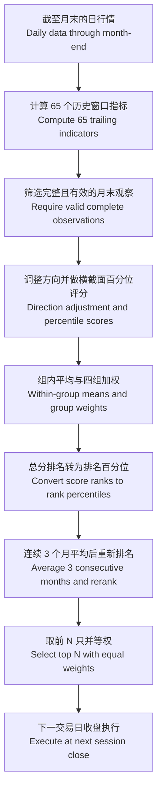

# 方法与读图说明 · Methodology and interpretation

本页说明 v0.1 的已实现行为；运行入口与全局流程见[项目 README](../README.md)。
This page describes implemented v0.1 behavior; see the [project README](../README.md) for commands and the overall workflow.

## 1. 研究对象与时间 · Scope and timing

两类策略共用月度调度、交易成本、日度净值和绩效统计。月末信号使用截至该日的信息，下一交易日收盘执行。
Both strategy families share monthly scheduling, transaction costs, daily NAV, and performance metrics. Month-end signals use information through that date and execute at the next session's close.

“月度”是决策频率；日度数据仍用于计算因子、估计风险和逐日记账。新持仓仅获得执行收盘之后的收益。
“Monthly” describes decision frequency. Daily data still support factors, risk estimation, and accounting. New holdings earn returns only after their execution close.

统一回测入口校验 XNYS 常规交易日历及完整价格面板；这不是香港市场或全部交易场所通用的日历。
The unified backtest validates the XNYS regular-session calendar and a complete price panel; this calendar is not universal across Hong Kong or other venues.

## 2. ETF 的三个对照方法 · Three ETF approaches

默认固定池包含 11 只行业 ETF；每个月末使用最近 504 个日简单收益观察值，参数可由配置文件修改。
The default fixed universe contains 11 sector ETFs. Each month-end uses the latest 504 daily simple returns; parameters can be changed in the configuration.

| 方法 / Method | 计算含义 / Interpretation |
| --- | --- |
| 等权 / Equal weight | 每个 ETF 的目标权重为 `1/N`。Each ETF receives a target weight of `1/N`. |
| 样本最小方差 / Sample minimum variance | 用去均值收益与 `T−1` 分母估计样本协方差，再求最小方差权重。Estimate sample covariance from demeaned returns with denominator `T−1`, then minimize portfolio variance. |
| 常相关收缩最小方差 / Constant-correlation shrinkage minimum variance | 将样本协方差向保留各资产方差、采用平均相关系数的目标矩阵收缩，再求最小方差权重。Shrink sample covariance toward a target preserving individual variances and using average correlation, then minimize portfolio variance. |

收缩矩阵为 `Σ_shrunk = (1−δ)Σ_sample + δF`，其中 `δ` 根据窗口数据估计并限制在 `[0,1]`，不是人为固定的混合比例。
The shrunk matrix is `Σ_shrunk = (1−δ)Σ_sample + δF`; `δ` is estimated from the window and clipped to `[0,1]`, rather than fixed manually.

两个最小方差方法求解 `min wᵀΣw`，约束为 `Σwᵢ=1`、`0≤wᵢ≤max_weight`；默认单标的上限为 25%。
Both minimum-variance approaches solve `min wᵀΣw`, subject to `Σwᵢ=1` and `0≤wᵢ≤max_weight`; the default per-asset cap is 25%.

这个目标最小化估计方差，不预测最高收益，也不保证未来风险最低。代码拒绝不满足正定要求的协方差矩阵，不静默修补。
The objective minimizes estimated variance; it neither predicts the highest return nor guarantees the lowest future risk. The code rejects covariance matrices that fail its positive-definiteness requirement rather than silently repairing them.

实现依据：[风险模型](../sector_backtest/risk_models.py)、[权重优化](../sector_backtest/portfolio.py)、[月度流水线](../sector_backtest/pipeline.py)。
Implementation: [risk models](../sector_backtest/risk_models.py), [portfolio optimization](../sector_backtest/portfolio.py), and [monthly pipeline](../sector_backtest/pipeline.py).

## 3. 个股如何从因子变成持仓 · From factors to stock holdings

目前使用 65 个已实现的价格／成交量指标：动量 20、反转 10、风险 15、流动性 20；具体定义见[因子目录](FACTOR_CATALOG.md)。
The current model uses 65 implemented price/volume indicators: 20 momentum, 10 reversal, 15 risk, and 20 liquidity indicators; definitions are in the [factor catalog](FACTOR_CATALOG.md).



1. **完整性 / Completeness.** 月末价格须有效、成交量须为正，65 个指标均须有限；缺失因子不补零，缺失月份不跳过。Month-end prices must be valid, volume positive, and all 65 indicators finite; missing factors are not zero-filled and missing months are not skipped.
2. **方向与标准化 / Direction and scaling.** 每个指标乘以注册表规定的方向，再在当月合格股票中按 `(升序平均名次−1)/(股票数−1)` 评分；该因子分数越大越好。Multiply each indicator by its registered direction, then score it as `(ascending average rank−1)/(stock count−1)` within that month's eligible cross-section; higher factor scores are better.
3. **组分数 / Group scores.** 先对同组因子分数取算术平均，再按下表权重相加；因子较多的组不会因此自动获得更大组权重。Average factor scores within each group, then apply the weights below; having more indicators does not automatically increase a group's weight.
4. **月排名 / Monthly rank.** 总分越高越好；按降序名次转换为 `(平均名次−1)/(股票数−1)`，此时排名百分位越小越好。Higher total scores are better; convert descending ranks to `(average rank−1)/(stock count−1)`, so lower rank percentiles are better.
5. **平滑与选择 / Smoothing and selection.** 默认取包括当前月在内的连续 3 个有效月的排名百分位均值，并从小到大重新排名；最终并列按股票代码升序选择前 N 只。By default, average rank percentiles across 3 consecutive valid months including the current month, then rerank from lowest to highest; final ties are resolved by ascending ticker before selecting the top N.

| 因子组 / Factor group | 默认权重 / Default weight |
| --- | ---: |
| 动量 / Momentum | 0.30 |
| 反转 / Reversal | 0.10 |
| 风险 / Risk | 0.40 |
| 流动性 / Liquidity | 0.20 |

所选股票目标权重均为 `1/N`，未选股票为 0。默认 `N=4`，对应每只 25%；数量与仓位上限必须兼容。
Selected stocks receive target weights of `1/N`, with zero for other stocks. The default `N=4` implies 25% each; selection size and the weight cap must be compatible.

任一决策日不足 N 只合格股票时，整个回测报错，不自动缩小持仓数、沿用旧持仓或转为现金。
If any decision date has fewer than N eligible stocks, the entire run fails rather than silently reducing holdings, retaining old holdings, or switching to cash.

比较基准为配置池全部股票等权，沿用同一调仓日和费用设置；它不是外部指数，也不是零成本买入持有组合。
The comparison baseline equally weights all configured stocks with the same rebalance schedule and cost settings; it is neither an external index nor a zero-cost buy-and-hold portfolio.

“65 个指标”不是“65 份独立有效证据”：不同窗口可能高度相关，指标方向、组权重与排名窗口都是需要验证的研究假设。
“65 indicators” does not mean “65 independent pieces of valid evidence”: different windows may be highly correlated, and directions, group weights, and ranking windows remain research hypotheses.

实现依据：[排名逻辑](../hkquant/ranking.py)、[个股回测适配](../quant_research/stock.py)。旧版独立排名接口支持的可选成分区间，不代表统一回测已经具备历史成分数据库。
Implementation: [ranking logic](../hkquant/ranking.py) and [stock backtest adapter](../quant_research/stock.py). Optional membership intervals in the legacy standalone ranking API do not mean the unified backtest has a historical membership database.

## 4. 费用如何从组合中扣除 · How costs are funded

`cost_bps=5` 表示对每笔买入及卖出名义金额收取 **5 bp = 0.05% = 0.0005**，包含首次建仓；它不是 5%。
`cost_bps=5` charges **5 bp = 0.05% = 0.0005** on bought and sold notionals, including initial entry; it does not mean 5%.

令 `V_before` 为执行价格下交易前资产加现金，`old_value_i` 为旧持仓市值，`w_i` 为目标权重，`c` 为费用率。忽略浮点残余现金时：
Let `V_before` be pre-trade assets plus cash at execution prices, `old_value_i` the old position value, `w_i` the target weight, and `c` the cost rate. Ignoring floating-point cash residuals:

```text
V_after = V_before − c × Σᵢ |wᵢ × V_after − old_valueᵢ|
交易费用 / Trading cost = c × (买入金额 / Buy notional + 卖出金额 / Sell notional)
```

目标持仓和费用共用同一笔资金，代码求解上述自融资条件，并保留微小的非负浮点现金残余。
Target positions and fees use the same capital. The code solves this self-financing condition and retains tiny nonnegative floating-point cash residuals.

**纯记账示例：** 首次全部现金建仓，`V_before=1`、`old_value_i=0`、`c=0.0005`、目标权重之和为 1，则 `V_after=1/(1+c)≈0.99950025`，费用约 `0.00049975`。
**Accounting-only example:** Starting entirely in cash with `V_before=1`, `old_value_i=0`, `c=0.0005`, and target weights summing to 1 gives `V_after=1/(1+c)≈0.99950025`, with a fee of approximately `0.00049975`.

这里的 1 是标准化初始资金，示例不是市场收益。引擎使用复权价格与可分割合成份额，不重复计入分红／拆股，也不是原始股数的券商结算账本。
Here, 1 is normalized starting capital, and the example is not a market return. The engine uses adjusted prices and fractional synthetic units, does not apply dividends/splits again, and is not a raw-share brokerage ledger.

实现依据：[交易执行](../sector_backtest/execution.py)。目标上限只在调仓时约束；此后价格变化可使实际权重超过目标上限。
Implementation: [trade execution](../sector_backtest/execution.py). The target cap applies at rebalancing; subsequent price changes can move actual weights above that cap.

## 5. 如何理解图表和指标 · Reading charts and metrics

| 输出 / Output | 阅读约定 / Convention |
| --- | --- |
| 净值 / NAV | 账本记录扣费后组合价值，初始资金默认为 1；HTML 净值曲线除以 `initial_cash` 归一化至初始值 1。The ledger records portfolio value after costs, with default initial capital of 1; the HTML NAV chart divides by `initial_cash` to normalize its starting value to 1. |
| 总收益与 CAGR / Total return and CAGR | 来自同一净值账本；CAGR 按每年 252 个交易日年化，并非日历年时长。Use the same net ledger; CAGR annualizes by 252 sessions per year, not elapsed calendar years. |
| 波动率 / Volatility | 日净收益的样本标准差乘以 `√252`。Sample standard deviation of daily net returns multiplied by `√252`. |
| 最大回撤 / Maximum drawdown | 指标表用正的损失幅度；回撤曲线使用不大于 0 的水下值，两者符号不同。The metric is a positive loss magnitude; the drawdown chart shows nonpositive underwater values. |
| 日损失 CVaR 95% / Daily loss CVaR 95% | 对日损失 `−净收益` 最差 5% 的精确样本质量求均值，边界样本可按比例计入；若这部分仍为盈利，可为负值。Mean of the exact worst 5% mass of daily losses `−net return`, with fractional boundary mass; it can be negative when that tail still consists of gains. |
| 交易名义金额 / Traded notional | 买入金额加卖出金额，不除以 2，也不自动年化。Buy plus sell notional, without halving or automatic annualization. |

开发期与留出期是同一连续账本的切片，不在边界清空或重新注资；区间指标从该区间首日的前一净值开始计算。
Development and holdout periods are slices of one continuous ledger; holdings and capital are not reset at the boundary. Period metrics start from the previous NAV of the first included day.

实现依据：[绩效统计](../sector_backtest/performance.py)。本地复现与测试的证据范围见[验证记录](VALIDATION.md)。
Implementation: [performance metrics](../sector_backtest/performance.py). See [validation records](VALIDATION.md) for the scope of local replication and test evidence.

## 6. 研究边界与后续版本 · Research limits and later versions

当前统一回测采用固定用户提供的股票池，不是经验证的历史时点成分池；可能存在选择偏差、幸存者偏差和复权历史修订。信号按时间截断不等于拥有 point-in-time 数据。
The unified backtest uses a fixed user-supplied universe, not verified historical point-in-time membership; selection bias, survivorship bias, and revised adjusted-price history may remain. Causal signal cutoffs do not establish point-in-time data.

合成演示验证程序链路；旧结果复现验证迁移一致性。两者都不能单独证明样本外预测能力；留出期一旦用于调参，就应披露这一事实。
Synthetic demonstrations verify the software workflow; replication verifies migration consistency. Neither alone proves out-of-sample predictive power, and use of the holdout for tuning must be disclosed.

v1.0 日度决策、v2.0 小时级、v3.0 AI 与新闻／论坛驱动的分钟／秒级计算属于[后续路线](VERSION_ROADMAP_ZH.md)，尚未实现。
Daily decisions in v1.0, hourly operation in v2.0, and AI plus news/forum-driven minute/second calculations in v3.0 are part of the [future roadmap](VERSION_ROADMAP_ZH.md), not implemented functionality.
